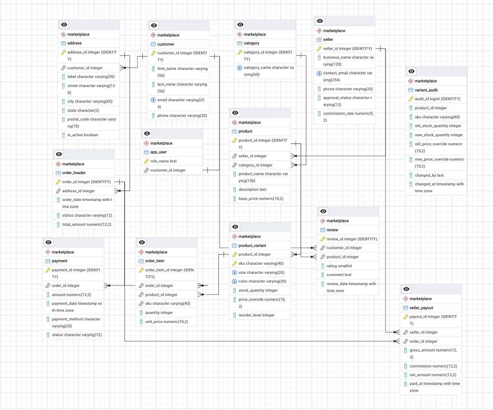

# Multi-Vendor Marketplace Database (PostgreSQL + Supabase)

A normalized (BCNF) PostgreSQL database for a multi-vendor e-commerce marketplace. Sellers list products with variants; customers place orders shipped to saved addresses, pay with one or more payments, and review products.

This repository is the complete final release of the CIT 406 Database Design term project at Atlantis University (Fall "A" 2026). It contains everything needed to rebuild the database from nothing: the schema, ordered migrations, seed data, the query portfolio, the logic layer, indexes, security roles and row-level security, plus a data dictionary and an entity relationship diagram.


---

## Contents

1. [What's in this repository](#whats-in-this-repository)
2. [Data model](#data-model)
3. [Rebuild the database from scratch](#rebuild-the-database-from-scratch)
4. [Verify the build](#verify-the-build)
5. [Logic layer](#logic-layer)
6. [Query portfolio](#query-portfolio)
7. [Indexes and performance](#indexes-and-performance)
8. [Security: roles and row-level security](#security-roles-and-row-level-security)
9. [Referential actions and business rules](#referential-actions-and-business-rules)
10. [Reset or remove the database](#reset-or-remove-the-database)
11. [Troubleshooting](#troubleshooting)
12. [Design notes](#design-notes)

---

## What's in this repository

```
.
├── build.sql                          # Runs everything below in order (psql)
├── migrations/
│   ├── 001_create_schema.sql          # Schema "marketplace" + 10 core tables, keys, CHECKs, FKs
│   ├── 002_logic_layer.sql            # 2 views, 2 functions, audit table + trigger, order procedure
│   ├── 003_seller_payout_reorder_level.sql  # seller_payout table, product_variant.reorder_level
│   ├── 004_indexes.sql                # Foreign-key indexes (+ Module 7 tuning decision)
│   ├── 005_roles_privileges.sql       # Roles mp_viewer and mp_staff with least privilege
│   ├── 006_row_level_security.sql     # Customer roles, app_user mapping, RLS policies
│   └── 007_comments.sql               # A description on every table and column
├── seed/
│   └── seed.sql                       # Sample data (rerunnable)
├── queries/
│   └── portfolio_queries.sql          # The 10 business questions (read-only)
├── tests/
│   ├── 00_verify_build.sql            # Pass/fail check of a rebuild
│   ├── 01_logic_layer_tests.sql       # Views, functions, trigger, commit + rollback
│   ├── 02_performance_tests.sql       # EXPLAIN ANALYZE before/after candidate indexes
│   └── 03_security_tests.sql          # Allowed/denied role tests and RLS per user
├── scripts/
│   └── generate_data_dictionary.sql   # Regenerates docs/data-dictionary.md from the database
├── docs/
│   ├── data-dictionary.md             # Every table and column described
│   ├── er-diagram.md                  # ERD (image + Mermaid)
│   ├── er-diagram.png                 # ERD of the built schema (pgAdmin 4)
│   └── module4-build/                 # Screenshots of the original Module 4 build
├── CHANGELOG.md
├── LICENSE                            # MIT
└── README.md
```

Everything lives in its own `marketplace` schema, so it never touches `public` or any other work in the same database. The only objects created outside that schema are five PostgreSQL roles (see [Security](#security-roles-and-row-level-security)).

---

## Data model



The diagram was generated from the built schema with pgAdmin 4's ERD tool. A Mermaid version that renders on GitHub is in [docs/er-diagram.md](docs/er-diagram.md), and every column is described in the **[data dictionary](docs/data-dictionary.md)**.

| Table | Primary key | Alternate key (UNIQUE) | Holds |
|---|---|---|---|
| `category` | category_id | category_name | Product categories |
| `seller` | seller_id | contact_email | Vendors and their approval status |
| `customer` | customer_id | email | Shoppers |
| `address` | address_id | — | A customer's saved shipping addresses (RLS protected) |
| `product` | product_id | — | Catalog items, each owned by one seller |
| `product_variant` | (product_id, sku) | (product_id, size, color) | Sellable versions of a product with stock and reorder level |
| `order_header` | order_id | — | One order, its shipping address, status and total |
| `order_item` | order_item_id | (order_id, product_id, sku) | Order lines with the price paid at checkout |
| `payment` | payment_id | — | Charges and refunds (an order can have several) |
| `review` | review_id | (customer_id, product_id) | One rating per customer per product |
| `seller_payout` | payout_id | (seller_id, order_id) | What each seller is paid for an order, after commission |
| `variant_audit` | audit_id | — | Log of every stock and price change (written by a trigger) |
| `app_user` | role_name | customer_id | Maps customer login roles to customers for RLS |

**Two design points worth knowing before you query:**

- **Orders reach their customer through the address.** There is no `customer_id` on `order_header`; join `order_header → address → customer`. Storing both would break BCNF, because an address always belongs to one customer.
- **Used addresses are never edited.** When a customer changes or removes an address, a new row is added and the old one gets `is_active = FALSE`, so past orders keep showing where they actually shipped.

`order_header` is named that way because `ORDER` is a reserved SQL word.

---

## Rebuild the database from scratch

### Prerequisites

| You need | For | Notes |
|---|---|---|
| A PostgreSQL **15 or newer** database | All options | Required for `UNIQUE NULLS NOT DISTINCT`. Every current Supabase project qualifies. |
| A login that can create roles | All options | The Supabase `postgres` user and a local superuser both can. |
| A free [Supabase](https://supabase.com) account | Options A–C | Or use Docker for a fully local setup (Option D). |
| `psql` | Options A and D | Ships with PostgreSQL; on macOS `brew install libpq`. |
| [pgAdmin 4](https://www.pgadmin.org/download/) | Option B | |
| [Docker](https://www.docker.com/) | Option D | |

Get the files:

```bash
git clone https://github.com/iamwaqarjaved/cit406-marketplace-database.git
cd cit406-marketplace-database
```

### Run order

Whatever tool you use, run these files **in this order**, each one completely:

| Step | File | Result |
|---:|---|---|
| 1 | `migrations/001_create_schema.sql` | Empty `marketplace` schema with 10 tables (drops any previous copy) |
| 2 | `migrations/002_logic_layer.sql` | Views, functions, `variant_audit` + trigger, `sp_place_order` |
| 3 | `migrations/003_seller_payout_reorder_level.sql` | `seller_payout` table, `reorder_level` column |
| 4 | `migrations/004_indexes.sql` | 8 foreign-key indexes |
| 5 | `migrations/005_roles_privileges.sql` | Roles `mp_viewer`, `mp_staff` and their grants |
| 6 | `migrations/006_row_level_security.sql` | Customer roles, `app_user`, 2 RLS policies |
| 7 | `migrations/007_comments.sql` | Descriptions on every table and column |
| 8 | `seed/seed.sql` | Sample data; ends with a row count per table |
| 9 | `tests/00_verify_build.sql` | 17 checks, all `PASS` |

`build.sql` does exactly this in one command for psql users. Every file is safe to rerun, and step 1 wipes the schema, so rerunning steps 1–9 always gives the same clean database.

### Option A: psql, one command (recommended)

In Supabase click **Connect** at the top of your project and copy the **Session pooler** URI (it works on every network; the direct connection needs IPv6). Then:

```bash
export DATABASE_URL="postgresql://postgres.<project-ref>:<password>@<pooler-host>:5432/postgres"

psql "$DATABASE_URL" -f build.sql
```

`build.sql` stops at the first error and prints a `==` header before each step. The last output is the build check table; every row should say `PASS`.

### Option B: pgAdmin 4 connected to Supabase

1. In Supabase, click **Connect** and copy the Session pooler host, port, database and user.
2. In pgAdmin, right-click **Servers → Register → Server…**
   - **General → Name:** anything, e.g. `Marketplace (Supabase)`
   - **Connection:** host, port, database (`postgres`), user and your database password
   - **Parameters:** set **SSL mode** to `require`
3. Expand the server, right-click the `postgres` database and choose **Query Tool**.
4. For each file in the [run order](#run-order): click the folder icon, open the file, and press **F5** to run the whole file. Wait for *Query returned successfully* before opening the next one.
5. After step 9, the Data Output tab shows the build check: every row should say `PASS`.
6. Right-click **Schemas → Refresh**. `marketplace` now shows 13 tables, 2 views, 4 functions/procedures and 1 trigger function.

pgAdmin shows only the result of the last statement in a file. That is expected: `seed.sql` ends with the row counts and `00_verify_build.sql` with the checks.

### Option C: Supabase SQL Editor (no install)

1. Sign in to Supabase and create a project (save the database password).
2. Open **SQL Editor → New query**.
3. For each file in the [run order](#run-order): paste the whole file and click **Run**. Use a new query tab, or clear the editor, for each file.
4. Step 9 shows the build check; every row should say `PASS`.

### Option D: local PostgreSQL with Docker

No Supabase account needed. Run from the repository folder:

```bash
docker run --name marketplace-db -e POSTGRES_PASSWORD=postgres \
  -v "$PWD":/repo -p 5432:5432 -d postgres:16

# wait a few seconds for the server to start, then:
docker exec marketplace-db psql -U postgres -f /repo/build.sql

# open an interactive session
docker exec -it marketplace-db psql -U postgres
```

You can also connect pgAdmin to `localhost:5432`, user `postgres`, password `postgres`.

---

## Verify the build

`tests/00_verify_build.sql` (step 9) counts what was built and compares it with the expected values:

| Check | Expected |
|---|---:|
| tables / views / functions + procedure / triggers | 13 / 2 / 4 / 1 |
| foreign keys / secondary indexes | 13 / 8 |
| tables with RLS / RLS policies / project roles | 2 / 2 / 5 |
| columns without a description | 0 |
| rows in customer / product_variant / order_header / order_item / payment / app_user | 5 / 14 / 7 / 13 / 8 / 2 |
| orders whose total does not match their lines | 0 |

The row counts printed at the end of `seed/seed.sql`:

| table_name | row_count |
|---|---:|
| category | 5 |
| seller | 4 |
| customer | 5 |
| address | 7 |
| product | 7 |
| product_variant | 14 |
| order_header | 7 |
| order_item | 13 |
| payment | 8 |
| review | 6 |
| seller_payout | 0 |
| variant_audit | 0 |
| app_user | 2 |

`variant_audit` starts empty because the trigger only writes to it when stock or a price override changes; `seller_payout` starts empty because no payouts have been run yet.

---

## Logic layer

Created by `migrations/002_logic_layer.sql`; exercised by `tests/01_logic_layer_tests.sql`.

| Object | Type | What it does |
|---|---|---|
| `v_order_summary` | View | One row per order: customer, ship-to city, item and seller counts, total, net paid (payments minus refunds) and balance due. |
| `v_storefront_catalog` | View | Every variant from **approved** sellers with its selling price (`price_override` or `base_price`), stock status and product rating. |
| `fn_order_total(order_id)` | Function | Sum of `quantity * unit_price` for an order's lines. |
| `fn_seller_payout(seller_id, from, to, commission_pct = 10)` | Function | What a seller earned in a period on paid, shipped and delivered orders, after commission. |
| `trg_variant_audit` | Trigger | After every change to a variant's `stock_quantity` or `price_override`, writes old value, new value, `current_user` and time to `variant_audit`. |
| `sp_place_order(address_id, items jsonb, payment_method, INOUT order_id)` | Procedure | Places an order as one unit: header, lines at the current price, stock decrement (row-locked), total and payment. Any failure (retired address, unapproved seller, not enough stock) raises an error and the whole transaction rolls back. |

```sql
SET search_path TO marketplace;

BEGIN;
CALL sp_place_order(7, '[{"product_id":1,"sku":"EB-BLK","quantity":2}]', 'card', NULL);
COMMIT;
```

`tests/01_logic_layer_tests.sql` places orders and changes stock. Rerun `seed/seed.sql` afterwards to return to the sample data.

---

## Query portfolio

`queries/portfolio_queries.sql` answers the ten business questions from the project proposal. All are read-only. Run `SET search_path TO marketplace;` once, then each query on its own.

| # | Question | Main SQL features |
|---:|---|---|
| 1 | Each seller's revenue over a date range | 4-table INNER JOIN, BETWEEN, IN, GROUP BY, SUM |
| 2 | Top-selling products by quantity last month | CTE, RANK() window function |
| 3 | A customer's full order history with status and payments | JOIN through address, LEFT JOIN to a payment aggregate |
| 4 | Orders containing items from more than one seller | GROUP BY … HAVING COUNT(DISTINCT) |
| 5 | Average rating per product vs. the marketplace average | LEFT JOIN, scalar subquery, CASE |
| 6 | Variants out of stock or below the reorder threshold | CASE, filter, ORDER BY |
| 7 | How each order's total splits across sellers | CTE, SUM() OVER (PARTITION BY) |
| 8 | Sellers ranked by average product rating | RIGHT OUTER JOIN, NULLS LAST |
| 9 | Variants in each category that have never sold | NOT EXISTS anti-join |
| 10 | Orders shipped to each address, including unused addresses | FULL OUTER JOIN, COALESCE |

---

## Indexes and performance

- Every **primary key and UNIQUE constraint** has its own index (migrations 001, 002, 003, 006).
- `migrations/004_indexes.sql` adds an index on **every foreign key** that is not already the leading column of a key: 8 indexes. PostgreSQL does not index foreign keys automatically, and these support joins and `ON DELETE` checks.
- **Module 7 performance pass** (`tests/02_performance_tests.sql`): every portfolio query was run with `EXPLAIN ANALYZE`. Two candidate indexes were tested, `order_header(order_date)` for Queries 1–2 and `product_variant(stock_quantity)` for Query 6. On the project's small tables the planner kept choosing a sequential scan and neither gave a measurable improvement, so **neither was kept**; the test script creates and then drops them. Queries 3 and 9 already use the foreign-key indexes.

---

## Security: roles and row-level security

### Roles and privileges (`migrations/005_roles_privileges.sql`)

| Role | Responsibility | Can | Cannot |
|---|---|---|---|
| `mp_viewer` | Read-only catalog analyst | SELECT category, product, product_variant, seller, v_storefront_catalog | Change any data; read customers, addresses, orders or payments |
| `mp_staff` | Inventory staff | Same SELECT; UPDATE **only** `stock_quantity` and `price_override` on product_variant; INSERT into variant_audit (needed by the audit trigger) | Change other columns; delete rows; read customers or payments |

Both are `NOLOGIN` group roles. In a real deployment a staff login is created and granted the role, e.g. `CREATE ROLE alice LOGIN PASSWORD '…' IN ROLE mp_staff;`.

### Row-level security (`migrations/006_row_level_security.sql`)

`address` holds each customer's private shipping addresses. RLS limits every customer to their own rows:

- `mp_customer` is the group role for customer logins; `cust_pedro` (customer 1) and `cust_aisha` (customer 2) are example logins.
- `app_user` maps each login role to its `customer_id` (rows loaded by the seed). It has its own policy, so a customer can see only their own mapping.
- Policy `address_owner_only`: `customer_id = (SELECT customer_id FROM app_user WHERE role_name = current_user)`.
- The table owner (the account that ran the build) is not subject to RLS, so admin queries still see every row.

### Test it (`tests/03_security_tests.sql`)

```sql
SET search_path TO marketplace;

SET ROLE cust_pedro;
SELECT address_id, customer_id, city FROM address;   -- addresses 1 and 2 only
RESET ROLE;

SET ROLE cust_aisha;
SELECT address_id, customer_id, city FROM address;   -- address 3 only
RESET ROLE;

SET ROLE mp_viewer;
SELECT * FROM customer;   -- ERROR: permission denied for table customer
RESET ROLE;
```

In pgAdmin, run `SET ROLE` together with the statement under it, then run `RESET ROLE;` on its own before the next test.

---

## Referential actions and business rules

Every foreign key states both actions explicitly. `ON UPDATE NO ACTION` is used wherever the referenced key is a generated ID, because those never change.

| Foreign key | ON DELETE | ON UPDATE | Business rule |
|---|---|---|---|
| `address.customer_id` → `customer` | CASCADE | NO ACTION | An address book belongs to its customer and is removed with the account. If any of those addresses was used by an order, the RESTRICT on `order_header.address_id` blocks the whole delete. |
| `product.seller_id` → `seller` | RESTRICT | NO ACTION | A seller with listed products cannot be deleted. They are suspended through `approval_status` so their catalog history stays intact. |
| `product.category_id` → `category` | RESTRICT | NO ACTION | Every product must have a category. A category in use cannot be removed until its products are moved. |
| `product_variant.product_id` → `product` | CASCADE | NO ACTION | A variant cannot exist without its product (weak entity). Deleting an unsold product removes its variants. |
| `order_header.address_id` → `address` | RESTRICT | NO ACTION | An order must always show where it shipped and, through the address, who placed it. Used addresses are retired, not deleted. |
| `order_item.order_id` → `order_header` | CASCADE | NO ACTION | Order lines are part of their order. Deleting an abandoned, unpaid order removes its lines. |
| `order_item.(product_id, sku)` → `product_variant` | RESTRICT | **CASCADE** | A sold variant cannot be deleted. If a seller renames a SKU, the new SKU flows into past order lines automatically. |
| `payment.order_id` → `order_header` | RESTRICT | NO ACTION | Payments are financial records. An order with a payment is cancelled or refunded through its status, never deleted. |
| `review.customer_id` → `customer` | CASCADE | NO ACTION | A review belongs to its author and is removed with the customer account. |
| `review.product_id` → `product` | CASCADE | NO ACTION | If an unsold product is removed from the catalog, its reviews go with it. |
| `seller_payout.seller_id` → `seller` | RESTRICT | NO ACTION | Payouts are financial records; a seller who has a payout cannot be deleted. |
| `seller_payout.order_id` → `order_header` | RESTRICT | NO ACTION | An order that has a payout cannot be deleted. |
| `app_user.customer_id` → `customer` | CASCADE | NO ACTION | A login mapping has no meaning without its customer. |

**The pattern:** CASCADE is used only where the child is part of its parent (addresses, variants, order lines, reviews, login mappings). RESTRICT protects anything with business or financial history. When a cascade reaches a RESTRICT, the RESTRICT wins and the whole delete is rolled back. `variant_audit` deliberately has no foreign keys, so its history survives deletes.

### Try the actions yourself

Each block runs inside a transaction and is rolled back, so your data is unchanged.

```sql
SET search_path TO marketplace;

-- RESTRICT: fails, seller 1 has products
BEGIN; DELETE FROM seller WHERE seller_id = 1; ROLLBACK;

-- RESTRICT: fails, order 1001 has a payment
BEGIN; DELETE FROM order_header WHERE order_id = 1001; ROLLBACK;

-- CASCADE + RESTRICT: fails, customer 1's address was used by an order
BEGIN; DELETE FROM customer WHERE customer_id = 1; ROLLBACK;

-- CASCADE: succeeds, removes Liam's saved address with his account
BEGIN;
DELETE FROM customer WHERE customer_id = 5;
SELECT COUNT(*) AS liam_addresses FROM address WHERE customer_id = 5;  -- 0
ROLLBACK;

-- ON UPDATE CASCADE: renaming a SKU updates past order lines
BEGIN;
UPDATE product_variant SET sku = 'EB-BLK-V2' WHERE product_id = 1 AND sku = 'EB-BLK';
SELECT order_item_id, sku FROM order_item WHERE order_item_id = 1;     -- EB-BLK-V2
ROLLBACK;
```

In the Supabase SQL Editor, run the failing examples one at a time: the editor stops at the first error.

### What the sample data shows

| Scenario | Where to look |
|---|---|
| An order shipped to an address the customer later retired | Order 1003 → address 4 (`is_active = FALSE`) |
| A refund recorded as a second payment | Order 1005 → payments 5 and 6 |
| One order paid with a gift card plus a card | Order 1007 → payments 7 and 8 |
| An order not yet paid | Order 1006 (`pending`, no payment) |
| A line sold below the current price | Order item 9: earbuds at 54.99 vs. 59.99 base price |
| A seller awaiting approval, with no products | Seller 4, Metro Threads |
| A category with no products yet | Category 5, Books |
| A customer with no orders | Customer 5, Liam Johnson |

---

## Reset or remove the database

- **Reload sample data only:** rerun `seed/seed.sql`. It empties every table (including the audit log and payouts) first.
- **Rebuild from scratch:** rerun `build.sql`, or every file in the [run order](#run-order).
- **Remove everything this project created:**

  ```sql
  DROP SCHEMA marketplace CASCADE;
  DROP ROLE IF EXISTS cust_pedro, cust_aisha, mp_customer, mp_viewer, mp_staff;
  ```

  Run the `DROP SCHEMA` first: a role cannot be dropped while it still holds privileges on objects. Nothing outside the schema and these five roles is affected.

---

## Troubleshooting

| Problem | Cause and fix |
|---|---|
| `syntax error at or near "NULLS"` | Your server is older than PostgreSQL 15. Check with `SELECT version();` and use a newer server. |
| `relation "category" does not exist` (or any table) while running a migration or the seed | A step was skipped or run against another database. Run the [run order](#run-order) from step 1 on one connection. |
| `relation "product" does not exist` in your own queries | The tables are in the `marketplace` schema. Run `SET search_path TO marketplace;` or write `marketplace.product`. |
| `permission denied to create role` | The login running the build cannot create roles. Use the Supabase `postgres` user or a superuser. |
| `role "mp_viewer" cannot be dropped because some objects depend on it` | Drop the schema first (see [Reset](#reset-or-remove-the-database)). If the roles also hold privileges in another database, run `REASSIGN OWNED BY … ; DROP OWNED BY …;` there. |
| A `SET ROLE` test returns rows for everyone, or the next test behaves oddly | The session is still in a test role. Run `RESET ROLE;` on its own; if pgAdmin shows *current transaction is aborted*, run `ROLLBACK;` then `RESET ROLE;`. |
| `psql: error: build.sql: … \ir` paths not found | Run psql from the repository folder, or pass the full path to `build.sql`; `\ir` resolves the other files relative to it. |
| pgAdmin cannot connect to Supabase | Use the **Session pooler** host from **Connect**, set SSL mode to `require`, and check the password (reset it under **Project Settings → Database** if needed). |
| Supabase warns that RLS is disabled on tables | That warning is about tables in `public`, which the Supabase API exposes. This project uses its own `marketplace` schema, which the API does not expose by default. |

---

## Design notes

This schema is the physical implementation of a design normalized to **Boyce-Codd Normal Form**:

- **The one decomposition:** the ERD's `ORDER` held both `customer_id` and `address_id`. Because `address_id → customer_id`, the customer column was removed and is reached through the address.
- **Controlled denormalization:** `order_header.total_amount` stores the checkout total (the amount the customer agreed to and payments reconcile against), even though it can be derived from `order_item`; `tests/00_verify_build.sql` checks it still matches. `address` keeps `city` and `state` beside `postal_code`, because a ZIP code does not reliably determine a single city. `seller_payout.net_amount` is stored because it is what was actually paid; a CHECK keeps it equal to `gross_amount - commission`.
- **`unit_price` is not redundant:** it records the price at the time of sale, which can differ from the variant's current price.

**Physical choices:**

- Identity keys: `GENERATED BY DEFAULT AS IDENTITY` (`ALWAYS` for the audit log).
- Money: `NUMERIC(10,2)` / `NUMERIC(12,2)`, never floating point.
- Timestamps: `TIMESTAMPTZ` with `now()` defaults.
- CHECK constraints: statuses, ratings, quantities, prices, reorder levels, payout amounts, state codes and ZIP formats.
- Migrations are additive and rerunnable; only `001` drops anything, so a full rebuild always starts clean.

Release history is in [CHANGELOG.md](CHANGELOG.md).

---

## Author

**Waqar Javed** · CIT 406: Database Design (Fall "A" 2026), Atlantis University · Instructor: Anshu Sharma
