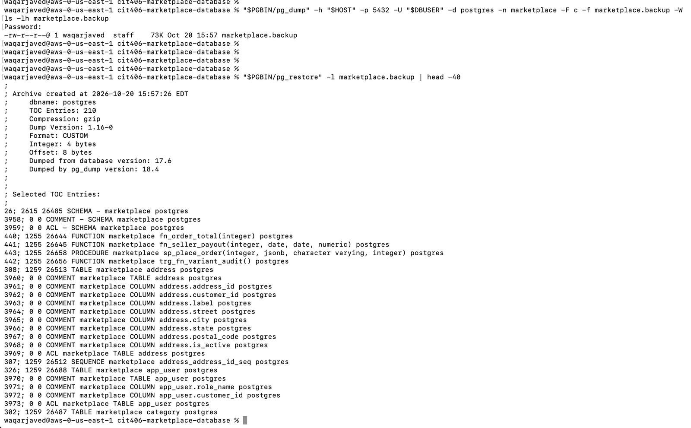
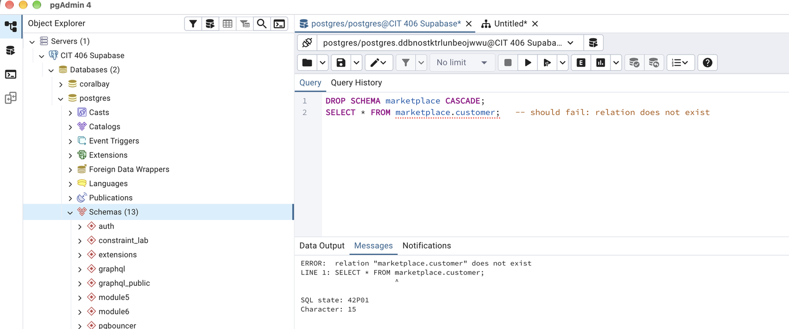
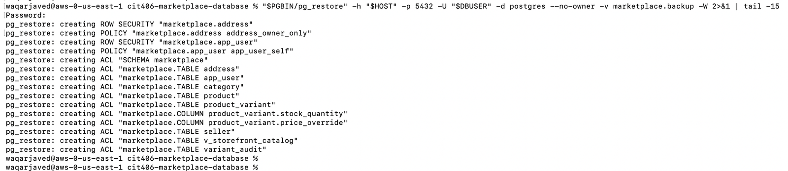
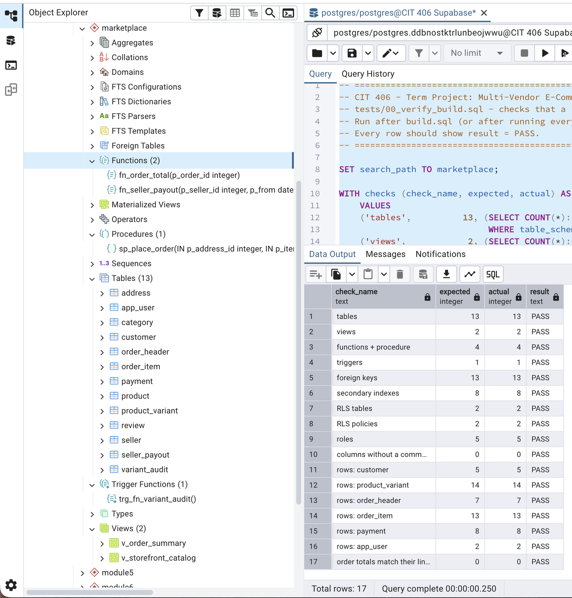

# Backup and Restore

`build.sql` rebuilds the database from source with sample data. To keep the **current data**, back it up with `pg_dump` and bring it back with `pg_restore`.

Use the Supabase **Session pooler** host on port 5432, found under **Connect** in your Supabase project or in pgAdmin under **server → Properties → Connection**. The transaction pooler on port 6543 does not support `pg_dump`. Each command asks for the database password because of `-W`.

## Where the tools are

`pg_dump` and `pg_restore` come with pgAdmin 4, so nothing extra has to be installed.

| OS | Path |
|---|---|
| macOS | `"/Applications/pgAdmin 4.app/Contents/SharedSupport/pg_dump"` (and `pg_restore` in the same folder) |
| Windows | `"%LOCALAPPDATA%\Programs\pgAdmin 4\runtime\pg_dump.exe"`; find it with `where /r "%LOCALAPPDATA%" pg_dump.exe` |
| Linux / Homebrew | `pg_dump` (from `postgresql-client` or `brew install libpq`) |

The macOS examples below use these variables:

```bash
PGBIN="/Applications/pgAdmin 4.app/Contents/SharedSupport"
HOST="aws-0-<region>.pooler.supabase.com"
DBUSER="postgres.<project-ref>"
```

## 1. Back up the marketplace schema

```bash
"$PGBIN/pg_dump" -h "$HOST" -p 5432 -U "$DBUSER" -d postgres \
  -n marketplace -F c -f marketplace.backup -W
```

- `-n marketplace` backs up only this project's schema: tables, data, views, functions, trigger, indexes, RLS policies, grants and comments.
- `-F c` uses the custom format, which is compressed and needed by `pg_restore`.

## 2. Verify the backup

```bash
"$PGBIN/pg_restore" -l marketplace.backup
```

This lists the archive's contents without restoring anything. You should see a `TABLE` and a `TABLE DATA` entry for each of the 13 tables, plus `VIEW`, `FUNCTION`, `PROCEDURE`, `TRIGGER`, `INDEX`, `POLICY`, `ROW SECURITY` and `ACL` entries.

## 3. Restore

First simulate data loss in pgAdmin:

```sql
DROP SCHEMA marketplace CASCADE;
SELECT * FROM marketplace.customer;   -- ERROR: relation does not exist
```

Then restore:

```bash
"$PGBIN/pg_restore" -h "$HOST" -p 5432 -U "$DBUSER" -d postgres \
  --no-owner marketplace.backup -W
```

`--no-owner` makes the login running the restore own the objects. That is required on Supabase and harmless elsewhere.

## 4. Check the restore

Run `tests/00_verify_build.sql`. All 17 checks should say `PASS`, and the data matches what was in the database when the backup was taken.

## Notes

- **Roles are not in the backup.** A dump covers one database's objects, while roles belong to the whole server. Restoring on the same server works because the roles still exist. On a new server, create the five roles first by running the `DO $$ … $$` blocks at the top of `migrations/005` and `006`, or just run `build.sql`.
- **Restoring over an existing schema fails** with "already exists" errors. Drop the schema first as shown above, or add `--clean --if-exists` to `pg_restore`.
- **Restore one table only:** add `-t <table>` to `pg_restore`.
- **Plain SQL backup:** `pg_dump … -n marketplace -f marketplace.sql` writes a readable SQL file that you restore with `psql -f`.

## Evidence: full cycle on Supabase (2026-10-20)

Run from macOS with pgAdmin 4's bundled `pg_dump` / `pg_restore` 18.4 against the project's Supabase database (PostgreSQL 17.6).

**1–2. Backup (73 KB, 210 entries) and its contents**



**3. Simulated data loss: schema dropped, queries fail**



**3. Restore: tables, data, RLS policies and grants recreated**



**4. After the restore: all 17 build checks PASS**


