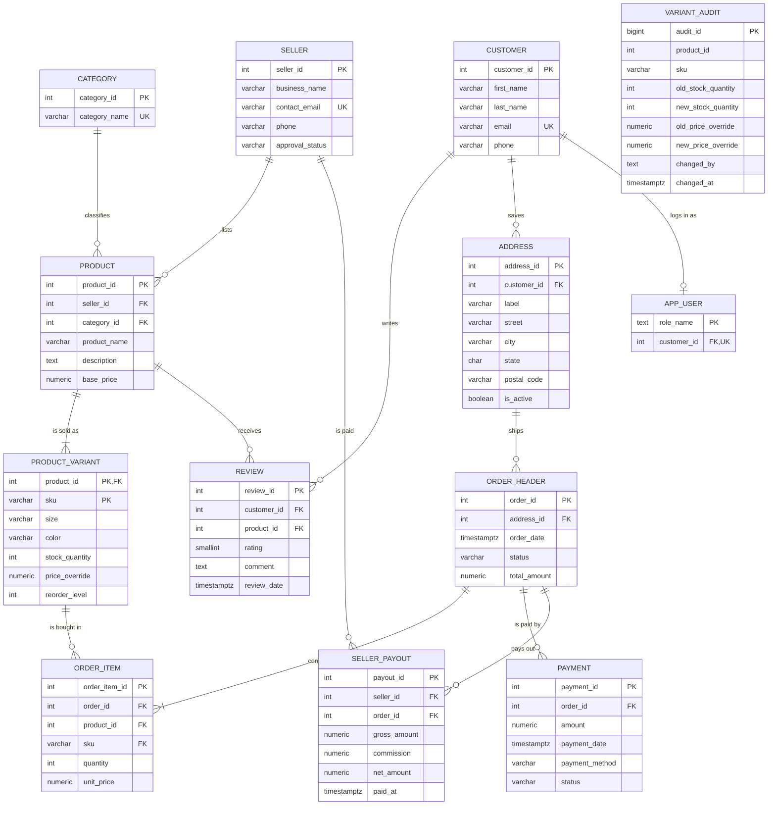

# Entity Relationship Diagram

## Built schema (pgAdmin 4 ERD tool)

Generated by pgAdmin 4's ERD tool from the `marketplace` schema in the course Supabase database. It shows all 13 tables, their columns, keys and foreign-key relationships.

## Same model as text (renders on GitHub)

Crow's-foot notation: `||` = exactly one, `o|` = zero or one, `o{` = zero or many, `|{` = one or many.

`VARIANT_AUDIT` has no relationship lines on purpose: it is an audit log filled by the `trg_variant_audit` trigger and has no foreign keys, so its history survives if a variant is later deleted.

Column-level detail (types, nullability, defaults, CHECK rules and descriptions) is in [data-dictionary.md](data-dictionary.md).
